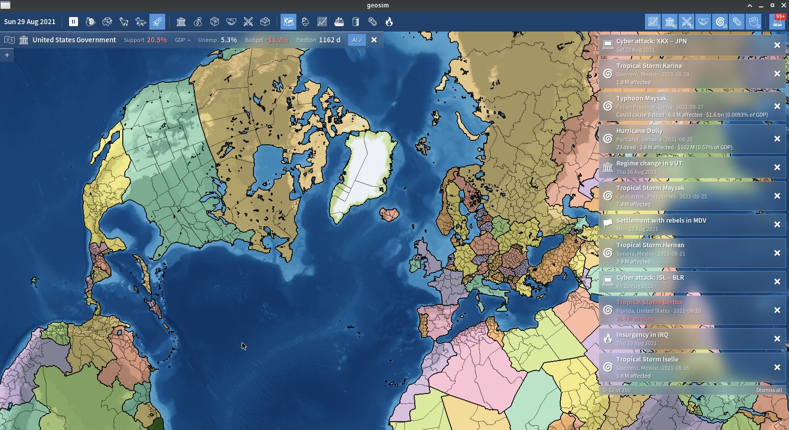
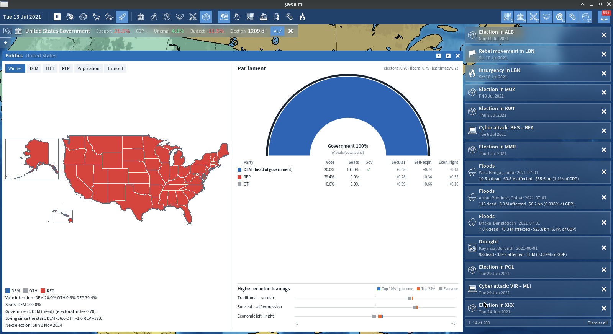

# geosim




Modern geopolitical simulator focused on the socioeconomic consequences of your actions.

## Docs

The design lives in [`docs/`](docs/README.md). Start with the
[gameplay loop](docs/01-gameplay-loop.md).

The engine builds with `-fno-exceptions -fno-rtti`; errors are reported through
`core::diagnostics` (docs/09).

## Build

Requirements: GCC or Clang (C++20), CMake >= 3.25, an AVX2+FMA CPU, and network
access at configure time to fetch DataContainer (and oneTBB if no system
package is installed).

```sh
cmake --preset dev && cmake --build --preset dev && ctest --preset dev
```

`ctest -L unit` runs the fast tests; `ctest -L backtest` runs the 2020 year
against real outcomes. The `full` preset also builds the game client (needs
SDL3, Vulkan, FreeType, HarfBuzz).

## Run the 2020 simulation

```sh
B=build/dev/src/geosim_headless
$B backtest --assets assets --scenario 2020                 # compare with real 2020
$B run --assets assets --scenario 2020 --daily out.csv      # daily indicators per nation
$B run --assets assets --scenario 2020 --flows USA          # the "Why?" flow ledger
$B run --assets assets --scenario 2020 --groups IND         # identity groups (caste, income, grievance)
$B run --assets assets --scenario 2020 --logistics 1        # chokepoints, queues, container freight
$B run --assets assets --scenario 2020 --no-events 1        # no-shock baseline (steady-state check)
$B run --assets assets --scenario 2020 --set historical_anchors=0   # the AI alone
$B build --assets assets --scenario 2020 --out s2020.bin    # assets -> DCON binary
$B run --load s2020.bin --days 90 --save day90.bin
```

Data: `python3 tools/pipeline/fetch.py && python3 tools/pipeline/build_assets.py`
regenerates `assets/` from the raw sources (see `assets/README.md`). What the
simulation covers today: [docs/12](docs/12-simulation-slice-2020.md).
